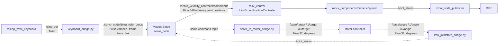

# Cartesian Control for a 5-DOF Manipulator with MoveIt Servo

Real-time Cartesian teleoperation of a custom 5-DOF robotic arm using **ROS 2 Humble** and **MoveIt Servo**. The operator drives the end-effector directly along X, Y and Z from the keyboard, and MoveIt Servo solves the inverse kinematics on the fly and streams joint commands to the arm, in simulation or through a microcontroller bridge to the real motors.

**Demo:** [cartesian_control.webm](cartesian_control.webm)

---

## Table of Contents

1. [Why Cartesian Control](#why-cartesian-control)
2. [System Architecture](#system-architecture)
3. [Robot Model](#robot-model)
4. [Repository Structure](#repository-structure)
5. [Getting Started](#getting-started)
6. [Running the Simulation](#running-the-simulation)
7. [Keyboard Controls](#keyboard-controls)
8. [Running on Hardware](#running-on-hardware)
9. [Configuration Reference](#configuration-reference)
10. [Known Limitations](#known-limitations)
11. [Tech Stack](#tech-stack)

---

## Why Cartesian Control

Robotic arms are usually commanded in **joint space**: the operator moves each motor individually to bring the tool to a target. For a multi-joint arm this is unintuitive, and straight-line tool motion is hard to coordinate by hand.

**Cartesian control** lets the operator command the end-effector itself. A request such as "move forward" or "move up" is sent as a velocity (twist) in the base frame, and MoveIt Servo computes the joint motion needed to produce it in real time.

---

## System Architecture



Solid arrows show the simulation loop. Dashed arrows show the extra bridges used when the real arm is connected.

### Nodes in this repository

| Node | File | Purpose |
|---|---|---|
| `twist_converter_node` | `src/keyboard_bridge.py` | Converts `Twist` from the keyboard into the `TwistStamped` that MoveIt Servo requires, stamping it with the current time and the `base_link` frame. |
| `servo_to_motor_bridge` | `src/servo_to_motor_bridge.py` | Subscribes to the Servo joint commands (radians), converts to degrees and republishes one `Float32` target per joint at 50 Hz with best-effort QoS for the microcontroller. |
| `angle_to_jointstate` | `src/imu_jointstate_bridge.py` | Closes the loop from hardware: reads measured joint angles (degrees), converts to radians and publishes `/joint_states` at 50 Hz. |
| `hardware_splitter_node` | `src/hardware.py` | Alternative output path that splits `/joint_states` into one `Float64` topic per motor. |
| `gripper_kinematics_node` | `src/manipulator1/scripts/gripper_kinematics.py` | Solves the gripper's four-bar linkage so the passive gripper joints follow the actuated ones in RViz. |

---

## Robot Model

The arm was designed in CAD and exported to URDF with STL meshes (`src/manipulator1`).

| Property | Value |
|---|---|
| Revolute joints in the URDF | 18 (actuated joints plus passive gripper and bevel linkage joints) |
| Positioning chain used by MoveIt Servo | `base_link` to `link3`, 3 joints: `base_link_j_base_plate`, `side_plate1_j_side_plate12`, `motor_holder_j_side_plate_12` |
| Wrist and gripper actuation | `link3_j_bevel1`, `bevel1_j_bevel_coupler` (bevel gear wrist) and `servo_j_gl1` (gripper) |
| Kinematics solver | KDL (`kdl_kinematics_plugin/KDLKinematicsPlugin`) |
| Control interface | Position commands through `ros2_control` |

URDF variants without the bevel wrist and without the gripper are included for simpler planning and debugging.

---

## Repository Structure

```text
.
├── cartesian_control.webm            # Demo recording
└── src/
    ├── keyboard_bridge.py            # Twist -> TwistStamped for MoveIt Servo
    ├── servo_to_motor_bridge.py      # Servo commands -> per-joint motor targets (degrees)
    ├── imu_jointstate_bridge.py      # Measured angles -> /joint_states
    ├── hardware.py                   # /joint_states -> per-motor topics
    ├── manipulator1/                 # Robot description package
    │   ├── urdf/                     # Full URDF and reduced variants
    │   ├── meshes/                   # STL meshes
    │   ├── launch/view_manipulator.launch.py
    │   └── scripts/gripper_kinematics.py
    ├── manipulator1_moveit_servo2/   # Final MoveIt + Servo configuration (use this one)
    │   ├── config/moveit_servo.yaml
    │   ├── config/ros2_controllers.yaml
    │   └── launch/servo.launch.py
    ├── manipulator1_moveit_servo/    # Earlier Servo configuration
    └── manipulator1_moveit_pkg*/     # Earlier MoveIt Setup Assistant iterations
```

The `manipulator1_moveit_pkg` to `manipulator1_moveit_pkg4` and `manipulator1_moveit_servo` packages are kept as a record of the configuration iterations. `manipulator1_moveit_servo2` is the working configuration described below.

---

## Getting Started

### Prerequisites

- Ubuntu 22.04 with ROS 2 Humble
- MoveIt 2 and MoveIt Servo
- `ros2_control`, `ros2_controllers`
- `teleop_twist_keyboard`

```bash
sudo apt update
sudo apt install ros-humble-moveit ros-humble-moveit-servo \
  ros-humble-ros2-control ros-humble-ros2-controllers \
  ros-humble-teleop-twist-keyboard
```

### Build

```bash
mkdir -p ~/ws_manipulator4
cd ~/ws_manipulator4
git clone https://github.com/Satyajit-147/cartesian-control-for-5-DOF-manipulator.git .
source /opt/ros/humble/setup.bash
colcon build
source install/setup.bash
```

To check the model on its own before running Servo:

```bash
ros2 launch manipulator1 view_manipulator.launch.py
```

---

## Running the Simulation

Four terminals are needed. Source the workspace in each one.

**Terminal 1: MoveIt Servo, controllers and RViz**

```bash
source ~/ws_manipulator4/install/setup.bash
ros2 launch manipulator1_moveit_servo2 servo.launch.py
```

Wait for RViz to load and the terminal output to settle.

**Terminal 2: start Servo**

MoveIt Servo starts paused for safety. Start it with a service call:

```bash
source ~/ws_manipulator4/install/setup.bash
ros2 service call /servo_node/start_servo std_srvs/srv/Trigger {}
```

A `success=True` response confirms that Servo is streaming.

**Terminal 3: keyboard bridge**

`teleop_twist_keyboard` publishes `geometry_msgs/Twist`, while MoveIt Servo requires `geometry_msgs/TwistStamped`. The bridge adds the timestamp and the `base_link` frame and forwards the command.

```bash
source ~/ws_manipulator4/install/setup.bash
python3 src/keyboard_bridge.py
```

**Terminal 4: keyboard teleop**

```bash
source /opt/ros/humble/setup.bash
ros2 run teleop_twist_keyboard teleop_twist_keyboard
```

---

## Keyboard Controls

Keep Terminal 4 focused while driving.

| Key | End-effector motion |
|---|---|
| `Shift` + `J` | Forward (+X) |
| `Shift` + `L` | Backward (-X) |
| `t` | Up (+Z) |
| `b` | Down (-Z) |
| `i` | Right (-Y) |
| `,` | Left (+Y) |
| `k` | Stop all motion |

`q` and `z` raise and lower the maximum speed in the teleop terminal.

---

## Running on Hardware

The same Servo output drives the physical arm through two bridge nodes. Joint angles are exchanged with the motor controller as `Float32` values in degrees, using best-effort QoS.

```bash
# Servo joint commands -> motor targets
python3 src/servo_to_motor_bridge.py

# Measured joint angles -> /joint_states
python3 src/imu_jointstate_bridge.py
```

| Direction | Topics | Type | Units |
|---|---|---|---|
| PC to motor controller | `/base/target`, `/l1/target`, `/l2/target` | `std_msgs/Float32` | degrees |
| Motor controller to PC | `/base/angle`, `/l1/angle`, `/l2/angle` | `std_msgs/Float32` | degrees |

When running on hardware, `/joint_states` should come from `imu_jointstate_bridge.py` instead of the simulated `joint_state_broadcaster`.

---

## Configuration Reference

Key settings in `manipulator1_moveit_servo2/config/moveit_servo.yaml`:

| Parameter | Value | Meaning |
|---|---|---|
| `move_group_name` | `panda_arm` | Planning group (name kept from the MoveIt template; it is the 3-joint arm chain) |
| `ee_frame_name` | `link3` | Frame that is driven in Cartesian space |
| `planning_frame`, `robot_link_command_frame` | `base_link` | Frame the twist commands are expressed in |
| `command_out_topic` | `/servo_velocity_controller/commands` | Where joint commands are streamed |
| `command_out_type` | `std_msgs/Float64MultiArray` | Joint positions (`publish_joint_positions: true`) |
| `publish_period` | `0.01` s | 100 Hz command stream |
| `scale.linear`, `scale.rotational` | `0.4` | Speed scaling for unitless twist input |
| `check_collisions` | `false` | Collision checking is disabled |

`config/ros2_controllers.yaml` runs the controller manager at 100 Hz with `servo_velocity_controller` configured as a `position_controllers/JointGroupPositionController` over the three arm joints.

---

## Known Limitations

- **Servo controls the 3-joint positioning chain.** The wrist and gripper joints are not part of the Servo planning group, so Cartesian commands position `link3` and do not control tool orientation.
- **Collision checking is off** in the Servo configuration.
- **Naming left over from templates.** The planning group is still called `panda_arm`, and `servo_velocity_controller` is a position controller despite its name.
- **Gripper kinematics are for visualisation.** Several passive-joint relationships in `gripper_kinematics.py` are placeholder ratios that have not been calibrated against the physical gripper.
- **Bridge scripts are standalone.** They are run with `python3` and are not yet installed as ROS 2 executables or started from a launch file.

---

## Tech Stack

| Layer | Technology |
|---|---|
| Middleware | ROS 2 Humble |
| Motion | MoveIt 2, MoveIt Servo, KDL kinematics |
| Control | ros2_control, ros2_controllers |
| Visualisation | RViz 2 |
| Robot model | URDF with STL meshes exported from CAD |
| Language | Python (rclpy) |
